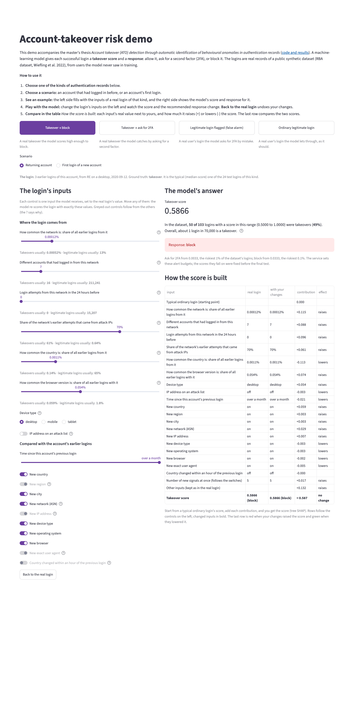

# Anomaly Detection ATO

[](https://github.com/astral-sh/uv)
[](https://github.com/charliermarsh/ruff)
[](https://github.com/pre-commit/pre-commit)
[](https://github.com/PyCQA/bandit)
[](https://mypy-lang.org/)

Repository for master's thesis project on **Account Take Over (ATO) detection** in authentication records using anomaly detection methodologies.

**Documentation, method and results:** <https://modsiw-mona.github.io/anomaly_detection_ato/>

**Live demo:** <https://anomalydetection-ato.streamlit.app>

## Features and Tools

Features                                     | Package  | Why?
 ---                                         | ---      | ---
Dependencies and env                         | [UV] | [article](https://astral.sh/blog/uv)
Lint - Format, sort imports  (Code Quality)  | [Ruff] | [article](https://www.sicara.fr/blog-technique/boost-code-quality-ruff-linter)
Static type checking                         | [Mypy] | [article](https://python.plainenglish.io/does-python-need-types-79753b88f521)
code security                                | [bandit] | [article](https://blog.bytehackr.in/secure-your-python-code-with-bandit)
Code quality & security each commit          | [pre-commit] | [article](https://dev.to/techishdeep/maximize-your-python-efficiency-with-pre-commit-a-complete-but-concise-guide-39a5)
Test code                                    | [Pytest] | [article](https://realpython.com/pytest-python-testing/)
Test coverage                                | [coverage.py] [codecov] | [article](https://martinxpn.medium.com/test-coverage-in-python-with-pytest-86-100-days-of-python-a3205c77296)
Project Template                             | [Cruft] or [Cookiecutter] | [article](https://medium.com/@bctello8/standardizing-dbt-projects-at-scale-with-cookiecutter-and-cruft-20acc4dc3f74)
Folder structure for data science projects   | [Data structure] | [article](https://towardsdatascience.com/the-importance-of-layered-thinking-in-data-engineering-a09f685edc71)
Template for pull requests                   | [Pull Request template] | [article](https://www.awesomecodereviews.com/pull-request-template/)
Template for notebooks                       | [Notebook template] |

## Set up the environment

1. Clone the repository:

    ```bash
    git clone https://github.com/modsiw-mona/anomaly_detection_ato.git
    cd anomaly_detection_ato
    ```

1. **macOS only:** LightGBM and XGBoost need LLVM's OpenMP runtime (official Homebrew formula,
   MIT licence). Linux CI runners already have it.

    ```bash
    brew install libomp
    ```

1. Set up the environment:

    ```bash
    make install_env
    ```

1. Activate virtual environment:

    ```bash
    source .venv/bin/activate
    ```

## Demo — account-takeover risk (issue #8)

A local [Streamlit](https://streamlit.io/) app scores a login with the selected model and shows the response tier
(allow, ask for 2FA, block) and the inputs behind the score. It runs only on your machine
(`127.0.0.1`), with Streamlit's usage statistics turned off (`.streamlit/config.toml`).

1. After [setting up the environment](#set-up-the-environment) (including `brew install libomp` on macOS), build
   the data and the model once (each step is idempotent; the notebooks take ~70 and ~2 minutes):

    ```bash
    make data intermediate features split
    make notebooks_run NB=notebooks/5-models/06-sap-model_selection-2026_11_03.ipynb
    make notebooks_run NB=notebooks/6-interpretation/07-sap-model_interpretation-2026_11_04.ipynb
    ```

1. Start the demo and open <http://127.0.0.1:8501>:

    ```bash
    make demo
    ```

The page is a simulated sign-in. Click a kind of outcome (a takeover blocked, one asked for 2FA, a false alarm, an
ordinary login) and a scenario (a returning account or an account's first login); each is a real test login. The
left side is the login attempt: every control is one input of the model, set to that login's value, with where
takeovers and legitimate logins usually are. Press **Log in** to see the screen the person would see (let in,
asked for a code, or held until they verify their identity) and what the system saw (the score, the thresholds
and how the score is built); change the attempt and log in again. *Take the guided tour* walks through each part.
`?example=<block|2fa|false-alarm|ordinary>&scenario=<returning|first>` in the URL opens a given scenario. Screenshots and details: [`notebooks/7-deploy/`](https://github.com/modsiw-mona/anomaly_detection_ato/blob/main/notebooks/7-deploy/README.md).



## Install dependencies

After init the environment to install a new package, run:

```bash
uv add <package-name>
```

Example to install [plotly](https://plotly.com/python/) in dev group:

```bash
uv add --group dev plotly
```

## Project structure

- [Data structure]
- [Pipelines based on Feature/Training/Inference Pipelines](https://www.hopsworks.ai/post/mlops-to-ml-systems-with-fti-pipelines)

```bash
.
├── .code_quality                       # ruff and mypy configuration
├── .github                             # CI, Dependabot, labels, pull request template
├── .streamlit/config.toml              # demo settings (local only, no usage statistics)
├── conf/dataset/<name>.yaml            # per-dataset column mapping, source, checksum and rules
├── data                                # 8-stage data layout (contents gitignored)
│   ├── 01_raw                          # downloaded dataset
│   ├── 02_intermediate                 # standard names, types, nulls, flags
│   ├── 03_primary                      # (unused)
│   ├── 04_feature                      # past-only behavioural features
│   ├── 05_model_input                  # dev/test split by user
│   ├── 06_models                       # fitted pipeline and its metadata
│   ├── 07_model_output                 # scores
│   └── 08_reporting                    # charts and metrics reports
├── docs                                # documentation site and dataset cards
├── zensical.toml                       # documentation site configuration
├── notebooks                           # proof of concept, one folder per step (issues #1 to #8)
├── src
│   ├── data                            # download, intermediate data, features, split, validation
│   ├── model                           # baselines, evaluation, Freeman model, selection, friction
│   ├── inference                       # scoring, alert tiers, explanations, what-if rules
│   └── pipelines                       # feature, training and inference pipelines (next phase)
├── tests                               # pytest suite, mirrors src/
├── Makefile                            # environment, data pipeline, demo, tests, checks
└── pyproject.toml                      # dependencies (uv)
```

## Credits

This project was generated from [@JoseRZapata]'s [data science project template] template.

---
[@JoseRZapata]: https://github.com/JoseRZapata

[bandit]: https://github.com/PyCQA/bandit
[codecov]: https://codecov.io/
[Cookiecutter]:https://cookiecutter.readthedocs.io/en/stable/
[coverage.py]: https://coverage.readthedocs.io/
[Cruft]: https://cruft.github.io/cruft/
[data science project template]: https://github.com/JoseRZapata/data-science-project-template
[Data structure]: https://github.com/modsiw-mona/anomaly_detection_ato/blob/main/data/README.md
[Mypy]: http://mypy-lang.org/
[Notebook template]: https://github.com/modsiw-mona/anomaly_detection_ato/blob/main/notebooks/notebook_template.ipynb
[pre-commit]: https://pre-commit.com/
[Pull Request template]: https://github.com/modsiw-mona/anomaly_detection_ato/blob/main/.github/pull_request_template.md
[Pytest]: https://docs.pytest.org/en/latest/
[Ruff]: https://docs.astral.sh/ruff/
[UV]: https://docs.astral.sh/uv/
