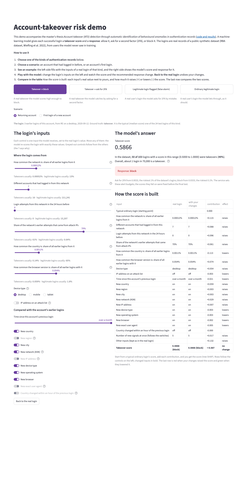
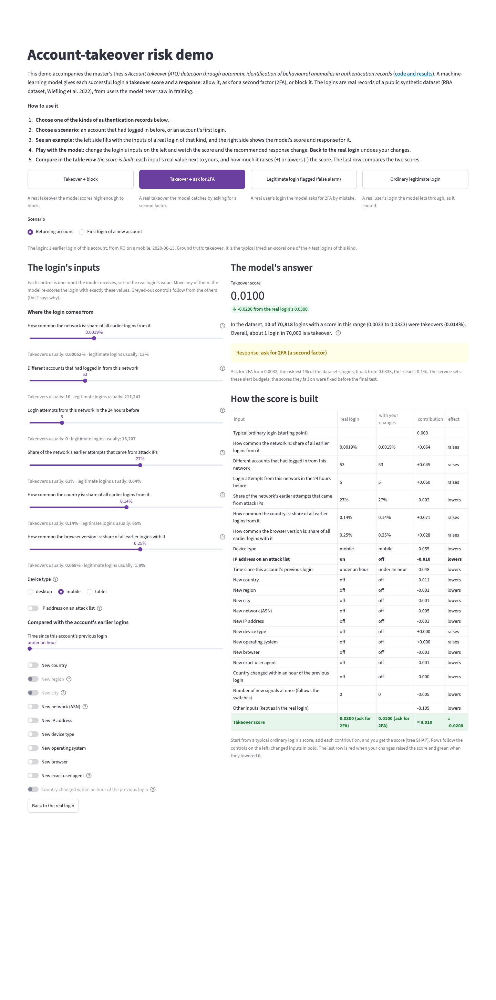

# Demo

**Live:** <https://anomalydetection-ato.streamlit.app> (the first visit may take a minute while the app wakes up and downloads its files).

A small web app ([Streamlit](https://streamlit.io/)) that puts the model in front of a person: pick a kind of
authentication record, see a real test login of that kind, then change any of its inputs and watch the score, the
response and its explanation change.

## How to use it

1. **Choose a kind of record:** a takeover the model blocks, a takeover it catches by asking for 2FA, a legitimate
   login flagged by mistake, or an ordinary legitimate login.
2. **Choose a scenario:** an account that had logged in before, or an account's first login.
3. **See the example:** the left side fills with the inputs of a real test login of that kind; the right side shows
   the model's score and response for it.
4. **Play with the model:** every control is one input the model receives. Sliders show where takeovers and
   legitimate logins usually are; inputs that follow from others are greyed out (a new network is always a new IP
   address, for example). **Back to the real login** undoes the changes.
5. **Compare in the table:** each input's real value next to yours, and how much it raises or lowers the score (tree
   SHAP contributions, which, added to a typical ordinary login's score, give this login's score).

## Screenshots



**A takeover blocked.** A returning account logs in from a network seen by only 7 accounts before, with a 70%
attack-IP history, from a rare country and browser: score 0.59, block.



**Changing one input.** A takeover asked for 2FA, with its attack-listed IP switched off: only that row changes,
and the last row turns green as the score falls from 0.0300 to 0.0100 (still ask for 2FA).

## Run it

The [public version](https://anomalydetection-ato.streamlit.app) runs on Streamlit Community Cloud from a small published bundle (the eight example logins,
the reference sample, the summaries and the model, each checked against its SHA-256 before it is loaded).

On your machine, after building the data and the model (see [Reproduce](reproduce.md)):

```bash
make demo
```

It listens only on `127.0.0.1`, with Streamlit's usage statistics turned off.
