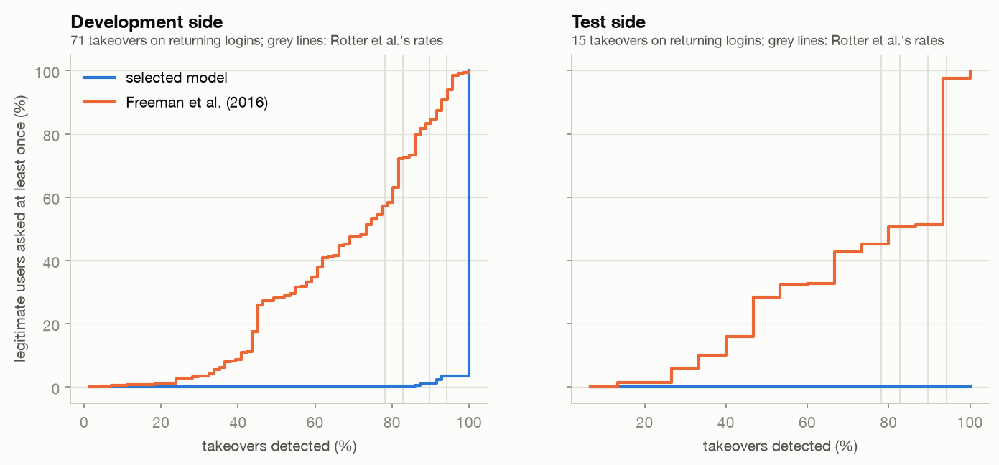

# Friction per user

The [Results](results.md) page measures friction per login (the share of logins challenged). The two studies on this dataset, Wiefling et
al. (2022) and Rotter et al. (2025), measure it **per user**: they set the threshold so that a given share of
takeovers is detected, then ask how often each legitimate user would have to re-authenticate. This page uses the same
metric, from the saved scores and the fixed thresholds; nothing is refitted.

For a threshold, the re-authentication rate of a legitimate user is the share of that user's logins scoring at
or above it. The friction of the threshold is the distribution of that rate over users.

## At the alert budgets

Test side, 553,756 legitimate users, about ten months:

| Tier | Takeovers caught | Median user | Average user | Users asked at least once |
| --- | --- | --- | --- | --- |
| Ask for 2FA (riskiest 1%) | 100% | 0% of logins | 1.1% of logins (about 1 in 90) | 2.4% |
| Block (riskiest 0.1%) | 86% | 0% | 0.11% | 0.27% |

The development side gives the same figures (2.5% and 0.28% of users), so the friction transfers to new users like
the thresholds do. The median is 0% because 97.6% of users are never asked and 43% have a single login; it is
reported because it is the number the two studies use, but the average and the share of users ever asked say more.

At the detection rates Rotter et al. report for the real takeovers (78.2% to 94.2%), the median test user is never
asked and 0.01% to 0.94% of users are asked at least once. With 28 test takeovers this is uncertain; resampling them,
the share of users ever asked stays below 1.3% (95% interval).

## Against the Freeman model

Freeman et al. (2016) is the established risk-based authentication model and needs the account's history, so the
comparison uses **returning logins**, the same ones for both models:

To detect 80% to 100% of the test takeovers, the Freeman model asks **51% to 100% of users** at least once, and its
median user re-authenticates on 5% to 100% of their logins. The selected model asks **at most 0.3%** of users. The
development side agrees up to 90% detection (Freeman: 58% to 85% of users); at 94% both reach almost everyone (the selected
model because the last few development takeovers score exactly 0, like 98% of legitimate logins). This is the direction Rotter et
al. report as well: a learned model clearly beats Freeman's on this dataset.

## Who carries the friction

At the 2FA tier, the share of each user's logins that is challenged is similar whatever the history length (0.8% to
1.3%), but users with many logins have more chances to be asked once: 1.3% of users with a single login, 18.7% of
those with 40 or more. **First logins are 28% of legitimate logins but 40% of the 2FA requests.** Part of that is the
dataset: the log starts in February 2020, so accounts that already existed look new at first (52% of the logins that
month are "first logins", against 18% in October). See [Limitations](limitations.md).

The full analysis, with bootstrap intervals and the travel-window check, is in
[notebook 08](https://github.com/modsiw-mona/anomaly_detection_ato/blob/main/notebooks/6-interpretation/08-sap-user_friction-2026_11_08.ipynb).
