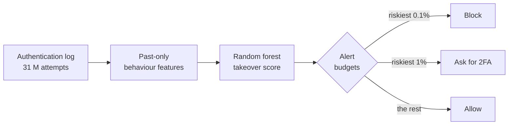

# Account-takeover detection

**Account takeover (ATO) detection through automatic identification of behavioural anomalies in authentication
records.** A master's thesis project (Universidad Pontificia Bolivariana) by Sofía Arango Patiño.

An account takeover is a successful login by someone who is not the account's owner, usually with stolen
credentials. The password is correct, so the login itself looks normal; what gives it away is *how* it differs from
the owner's habits and from everyone else's logins. This project learns those differences from authentication
records and turns them into a **takeover score** for every successful login, and a **response**: allow it, ask for a
second factor (2FA), or block it.

## In numbers

Measured on users the model never saw in training (28 takeovers among 1.97 million logins):

| Measure | Test result |
| --- | --- |
| **PR-AUC** (main metric) | **0.62** (95% interval 0.45–0.78), against a chance level of 0.000014 |
| **Takeovers caught** when the riskiest **1%** of logins are asked for 2FA | **100%** (28 of 28) |
| **Takeovers caught** when the riskiest **0.1%** of logins are blocked | **86%** (24 of 28) |
| **Legitimate users** asked for 2FA at least once in ten months | **2.4%** (the median user: never) |
| Users asked at least once to catch 80–100% of takeovers on returning logins | **at most 0.3%**, against 51–100% for the established Freeman et al. (2016) model |

## How it works

* **Data:** the public [RBA dataset](datasets/rba.md) (Wiefling et al., 2022): 31 million login attempts to a large
  single sign-on service, synthesised from real behaviour, with 140 confirmed takeovers on successful logins.
* **Features:** for each login, only what was known *before* it: is this country, network or device new for the
  account, how rare it is among all logins, how many accounts share the network, recent failures and attack
  activity around it, impossible travel. See [Method](method.md).
* **Evaluation:** users are split once into development (80%) and test (20%); every choice is made on development
  users, and the test users are scored at the end. See [Results](results.md).
* **Demo:** a web app that scores real test logins and lets you change any input to see how the score moves.
  **[Open the live demo](https://anomalydetection-ato.streamlit.app)**, or see [Demo](demo.md).

## Where to go next

* [Method](method.md): problem, features, evaluation protocol, model selection.
* [Results](results.md): the final measurement, what the model relies on, where it fails.
* [Friction per user](friction.md): how often a legitimate user would be asked to re-authenticate.
* [Limitations](limitations.md): what this dataset and this design cannot show.
* [Reproduce](reproduce.md): run everything on your machine.

The code is open on [GitHub](https://github.com/modsiw-mona/anomaly_detection_ato). The dataset is licensed
CC BY 4.0; the code under the MIT licence.
