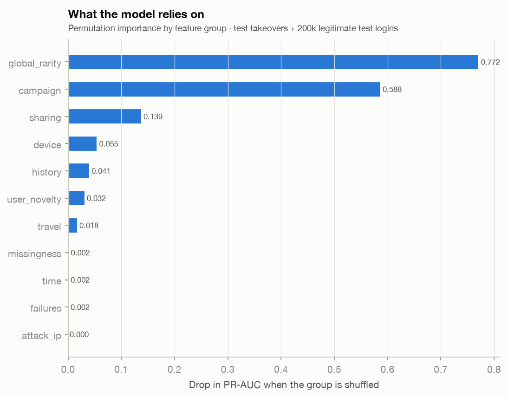
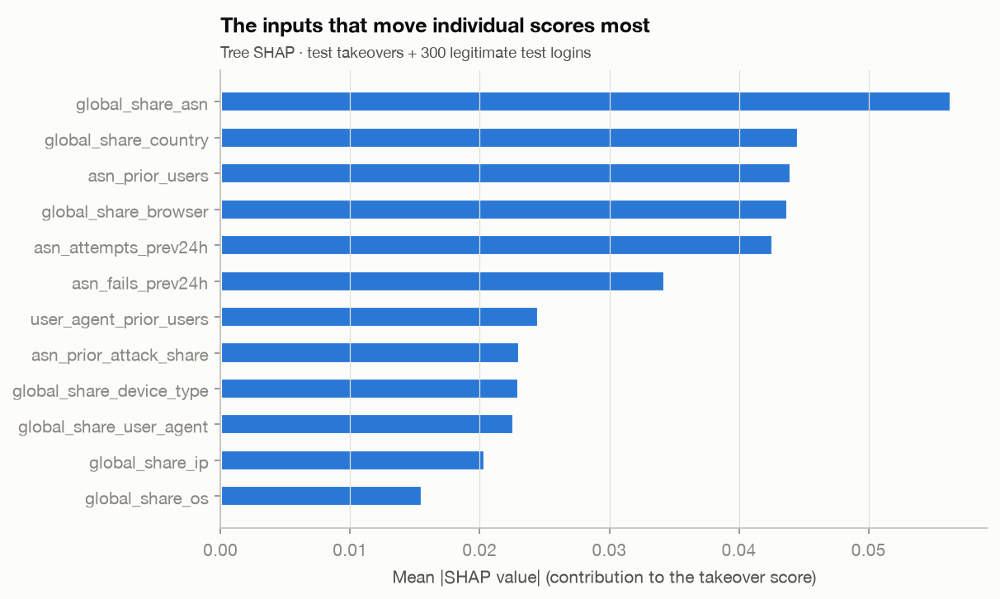
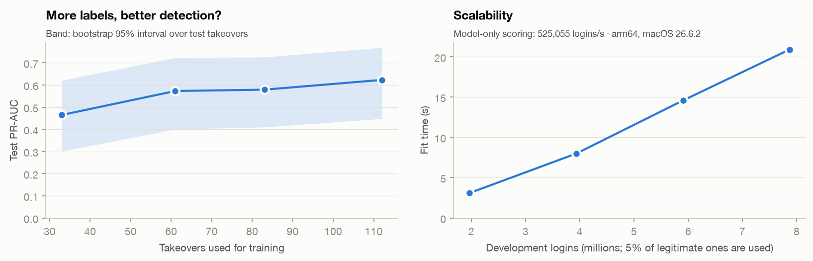

# Results

The selected model was refitted on all development users and scored the **test side**: 553,756 users, 1,971,980
successful logins, 28 takeovers. Nothing was tuned after that measurement.

!!! note "One earlier test run"
    An earlier run, before a preprocessing bug was fixed (networks never seen before were imputed as clean), scored a
    different model on the test side: LightGBM with the `campaign` and `travel` features, PR-AUC 0.606 (0.434 to
    0.765). The bug was found in code review; model selection was then re-run on development data only, with the
    selection rule coded before the run, and chose the random forest. The earlier test result was known at that
    point, but no test number entered the choice (notebook 07).

## The final measurement

| Metric | Development (15 folds) | Test |
| --- | --- | --- |
| **PR-AUC** | 0.448 | **0.623** (95% interval 0.454–0.777) |
| Recall, riskiest 0.1% of logins | 81% | **86%** (24 of 28) |
| Recall, riskiest 1% of logins | 89% | **100%** (28 of 28) |

The chance level of PR-AUC is the prevalence, 0.000014. The test value is higher than the development estimate, with
overlapping intervals: the final model is trained on more data, and 28 takeovers make any test number uncertain.
ROC-AUC is 0.9996, but at this imbalance it says little: it stays near 1 even with hundreds of false alarms per
takeover.

**Thresholds transfer to new users.** The two thresholds were set on development scores before the test side was
opened; on the test side they flag 0.094% and 0.95% of logins, within the budgets.

**Leakage checks.** No user is on both sides, and every feature uses only the past. The very top of the ranking rests
on attack-IP and burst signals; if the dataset's attack-IP flag was matched after the fact, these numbers are an
upper bound for a live system. With the attack-IP columns shuffled, PR-AUC halves (0.62 to 0.32), but 82% of the
takeovers are still in the riskiest 0.1% and 89% in the riskiest 1%: the result does not hinge on one column.

## What each error costs

| Tier | False alarms per takeover caught | In practice |
| --- | --- | --- |
| Block (riskiest 0.1%) | 76 | about 30 holds a day across the whole service |
| Ask for 2FA (riskiest 1%) | 668 | 2.4% of legitimate users asked at least once in ten months |

A missed takeover is much more expensive than a 2FA prompt, so a two-tier policy fits: strong verification for the
riskiest 0.1%, a second factor up to 1%. The per-user view of this friction is on
[Friction per user](friction.md).

## What the model relies on

In order: the **global rarity** of the login's values (network, country, browser), then **attacker
infrastructure** (recent activity and attack-IP history of the network, a user agent shared across accounts,
accounts already seen on the network), then device type, dormancy, novelty for the account and impossible travel.
The model is driven more by *where a login comes from* than by whether it is new for the account: on the
development side, 43% of legitimate returning logins bring some new signal for the account, against 86% of the 71
returning takeovers.

## Where it fails

* **First logins with common client values:** 3 of the 4 takeovers missed at the block tier. With no history and
  nothing rare about the login, nothing distinguishes the attacker.
* **One takeover** after an earlier login from the same country that is labelled legitimate.
* **False alarms** are mostly travellers and users of rare networks.

## Learning curve

Retrained on a growing share of the development users, the model reaches test PR-AUC 0.47 with 33 takeovers, 0.57
with 61, 0.58 with 83 and 0.62 with all 112. More labels seem to help, but the intervals overlap, so this is a trend,
not an established result. The model alone scores about 500,000 logins per second on a laptop; computing the
features in real time was not measured.

## Answer to the thesis objectives

The thesis has four specific objectives: characterise the dataset (1), build behavioural and anomaly features (2),
implement and compare supervised models that handle the imbalance (3), and evaluate the final model and build a
prototype (4). These results answer objective 4 (recall, precision, PR-AUC, thresholds and error analysis); the
[model selection](method.md#model-selection) answers objective 3, and the [features](method.md#features-only-the-past)
objective 2. Details and every intermediate result are in the notebooks of
[issues #1 to #8](https://github.com/modsiw-mona/anomaly_detection_ato/tree/main/notebooks).
