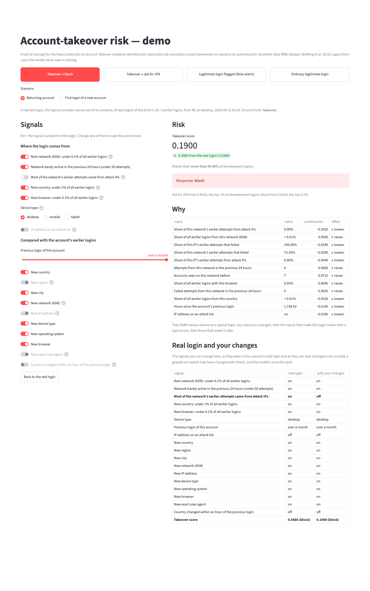

# 7 · Demo POC — account-takeover risk

Issue [#8](https://github.com/modsiw-mona/anomaly_detection_ato/issues/8) (CRISP-DM *deployment*; thesis objective
**OE4**, demonstrable prototype). Run instructions are in the [repository README](../../README.md#demo--account-takeover-risk-issue-8).

## What it does

- **Choose a scenario, not a row number.** Buttons at the top pick a kind of outcome: takeover blocked, takeover
  asked for 2FA, legitimate login flagged (false alarm), ordinary legitimate login. Each
  kind offers two scenarios, a **returning account** and an account's **first login**; each is a real login from
  the **test side** of the split (users the model never saw), the median-score login of its scenario.
- **Response names.** The demo shows the tiers of issue #7 in plain words: *block* for review / block (top 0.1%
  of development scores) and *ask for 2FA* for step-up authentication, a second factor (top 1%).
- **Model:** the pipeline selected in issue #6 (`data/06_models/rba_model.joblib`, random forest on the
  behavioural, rarity, campaign and travel features), loaded with `src/inference/predict.py`.
- **Output:** the takeover score, how it ranks among development logins, the **response tier** with the thresholds
  of issue #7, and **why**: tree SHAP contributions relative to a
  typical login (300 ordinary test logins), so "raises" means "riskier than a typical login".
- **Signals.** Every signal is a control set to the login's real value (on = the signal is present). Change
  any of them and the login is re-scored on the spot; inputs you changed are listed first under *Why*. They cover
  the input groups that weigh most in the model (notebook 07: global rarity, network activity and attack history,
  accounts sharing the network, device type, time since the previous login, account novelty).
    - *Where the login comes from:* rare network (under 0.1% of all earlier logins), network barely active in the
      previous 24 hours (under 50 attempts), most of the network's earlier attempts from attack IPs, rare country
      (under 1%), rare browser (under 0.1%), device type, and an attack-listed IP. Flipping one of the first five
      replaces its group of inputs with those of one real test login on the other side of the threshold; taking
      one real login, not a value per input, keeps the relations between its inputs (an IP never has more
      accounts or logins than its network). The three network switches describe one network, so flipping any of
      them takes all the network's inputs from a login matching all three switches at once (all eight
      combinations occur in the test data): the one **most similar to the scenario's login on the inputs of the
      switches left as they were** (`nearest_row` in `src/inference/what_if.py`: squared differences in standard
      deviations, on a log scale for shares of all logins and for counts; a value missing on one side only, such
      as an IP never seen before, counts as far apart). So turning off *most attempts from attack IPs* keeps a
      rare, quiet network and an IP never seen before, and changes the attack history. Device type and rare
      browser likewise describe one client, so changing either takes the device's and the browser's inputs from a
      login matching both (a browser that fits the device; all six combinations occur), with the browser most
      like the scenario's when only the device changed. The country switch is the only input of its group and
      takes the typical (middle) login on the other side. In development, 94 of the 112 takeovers were on a
      desktop: desktop logins were about 10 times more often takeovers than mobile ones.
    - *Compared with the account's earlier logins:* the time since the previous login, then new country, region,
      city, network, IP address, device type, operating system, browser, exact user agent, and a country change
      within an hour. On an account's **first** login there is no earlier login to compare with, so these are
      greyed out.
- **Rules between signals.** A control a rule fixes is greyed out and shows why on hover; once the rule no longer
  applies it gets back the value the viewer had given it, and "Back to the real login" resets everything. Rules
  are applied until they all agree (`src/inference/what_if.py`). Each holds without exception on the 7.1 million
  returning-account logins of the RBA feature table, and `tests/inference/test_what_if.py` checks them there:
    - something nobody had used before (country, network, IP, device type, operating system, browser, user agent)
      is new for this account too;
    - a new network means a new IP address; a new device type, operating system or browser means a new user
      agent; a new country means a new region when the region is known (no rule when the region or city is
      unknown);
    - a country change within an hour needs the previous login less than an hour earlier; a new country less
      than an hour after the previous login is a country change; if the account had used only one country, a
      country change is a new country;
    - every earlier attempt from an attack-listed IP is an attack attempt, and none from another IP, so the
      attack-IP switch also sets that IP's attack history; an IP's attempts are part of its network's, so a
      network with no earlier attack attempts has no attack-listed IP, and one whose earlier attempts all came
      from attack IPs has only attack-listed IPs.

  More follow from the definitions when a *where from* control replaces a value that was not new for the account:
  if the account had only one earlier login, a different network, browser (and its operating system) or device
  type (and its operating system and browser) is new for it; if it had used only one country, a different country
  is new. And when the account had used only one country and its previous login was less than an hour earlier, a
  country change is the same thing as a new country, so the travel switch follows "New country".
- **Definitions on hover, where needed.** A "?" explains the controls whose name uses a technical term (ASN,
  attack IPs, user agent, impossible travel) or a rarity threshold; plain ones such as "New IP address" have none.
  When a rule greys a control out, the "?" gives the reason.
- **Real login and your changes** (right, under *Why*): every signal you can change, as it was in the scenario's
  real login and as it is now (changed ones in bold), with the takeover score and response of each as the last
  row. Each scenario starts from one real test login, and the controls make a what-if version of it.
- **Plain-language names:** every input on screen is shown by what it means (e.g. "Share of all earlier logins
  from this country").

**What the switches show about the model.** On these scenarios, where a login comes from moves the score more
than what is new for the account, and the switches do not add up: the forest learned combinations. On the
returning-account takeover (0.5866, block), turning off one *where from* switch at a time gives 0.13 (rare
network), 0.16 (quiet network), 0.19 (attack history), 0.28 (rare country) and 0.02 (rare browser, ask for 2FA);
all five off give 0.0000 (allow). On the first-login takeover (0.7433), turning off *rare network* gives 0.01 (ask
for 2FA). The device type matters too: the returning-account takeover on a mobile or a tablet instead of a desktop
(with a browser that fits it) drops to 0.09 and 0.08. The attack history weighs this much because the data says
so: in development, logins from a rare, quiet network with mostly attack-IP history were takeovers 27 times in
10,000, against 0.8 in 10,000 for a rare, quiet network without it. The account-novelty switches move scores
less: on the ordinary returning-account scenario no combination of them changes the response. Novelty is common
in legitimate traffic too: 43% of legitimate returning-account logins in development bring a new country,
network, device type, operating system or browser for the account (41% a new IP address), against 86% of the 71
returning-account takeover logins.

**Why not a form or a CSV upload?** A common demo design scores one row typed in a form, or a batch from a
CSV. Here a login's features describe it *against the account's history and all earlier traffic* (novelty, rarity,
network reputation), so they cannot be typed in from one raw login. The demo therefore starts from real logins the
model never saw, and lets you change their signals.

The model receives the data and produces predictions correctly: `tests/inference/` checks thresholds, tiers,
loading, explanations and value formatting, and runs the whole app with Streamlit's test runner on a toy data
directory (`tests/inference/test_app.py`): switches reach the model and the changed inputs are listed first, the
comparison table shows only the signals and ends with the score, technical terms are explained,
implied signals follow their cause and return to their real value when it is switched off, the travel switch
follows the time since the previous login and gets back the viewer's value when the rule no longer applies, the
device type reaches the model, a first login greys out the history
signals, and "back to the real login" restores the original score. On the real data, every scenario was also
driven through 60 random control changes: no rule was broken and every reset restored the original score.

## Evidence

| | |
| --- | --- |
|  | **Takeover blocked (returning account).** Three earlier logins; this one comes from a rare network, quiet in the previous 24 hours, with a 70% attack-IP history, from a rare country and browser. |
|  | **Takeover on a new account's first login.** There is no earlier login to compare with, so the account-history signals are greyed out; the score comes from where the login comes from. |
|  | **The same returning-account takeover, attack history switched off.** The network stays rare and quiet and the IP stays one never seen before; only the attack history changes (70% to 0%). The score drops from 0.59 to 0.19, still block. The changed inputs are listed first under *Why*, and *Real login and your changes* shows the switch in bold with both scores. |
|  | **False alarm (returning account).** A legitimate login asked for 2FA: the score comes from a combination of smaller signals. |

Screenshots taken from the running app with headless Chrome (temporary profile) on 2026-11-08. The demo binds to
`127.0.0.1` with Streamlit's usage statistics off, both in `make demo` and in `.streamlit/config.toml`.
