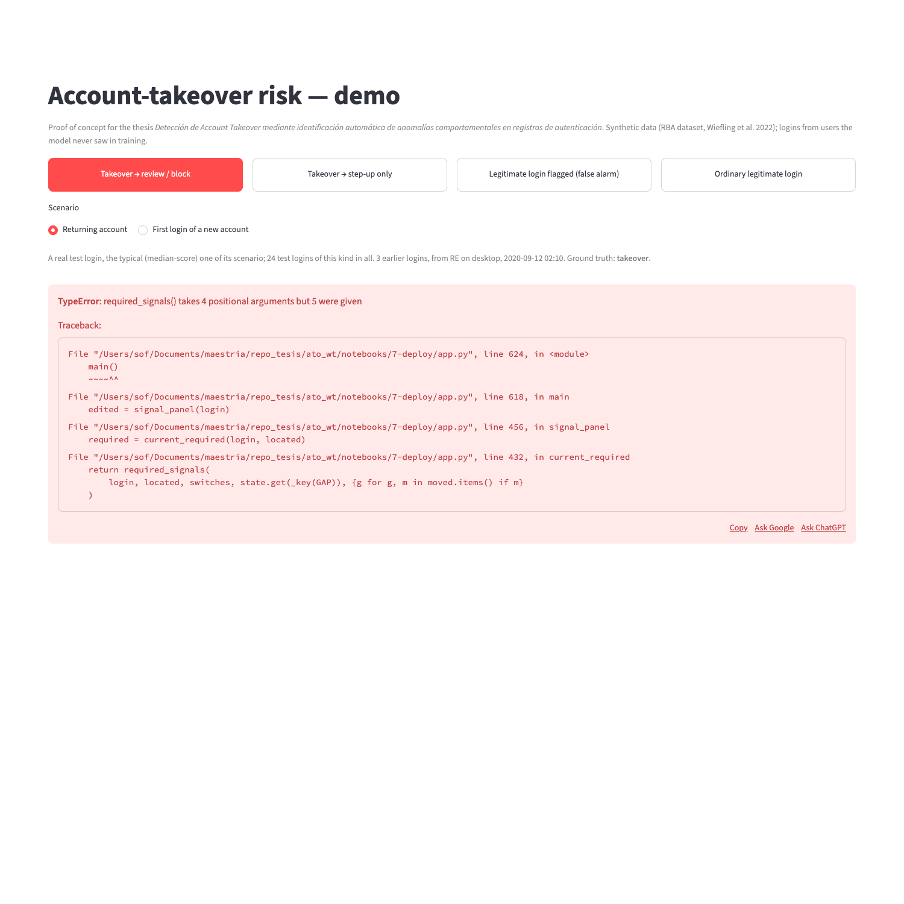
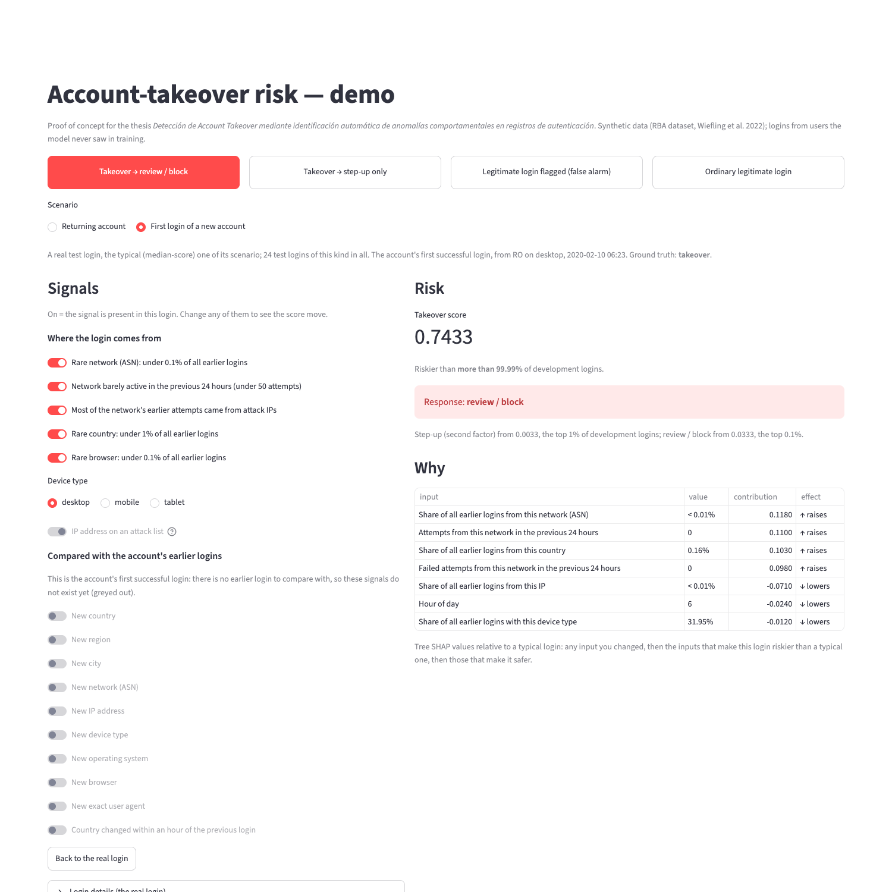
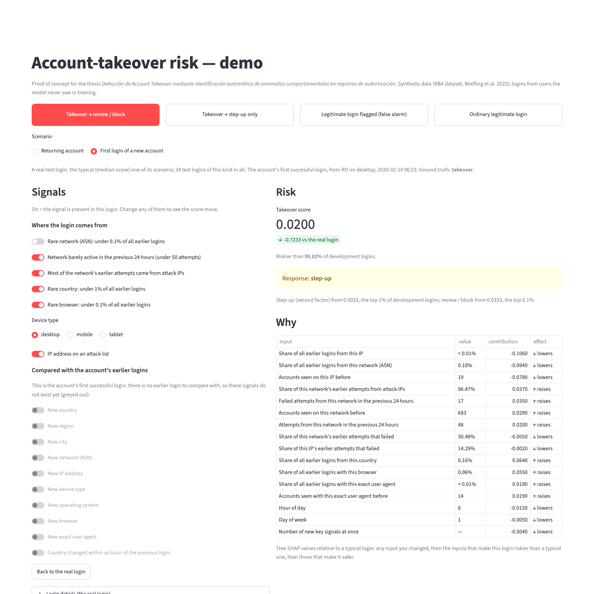
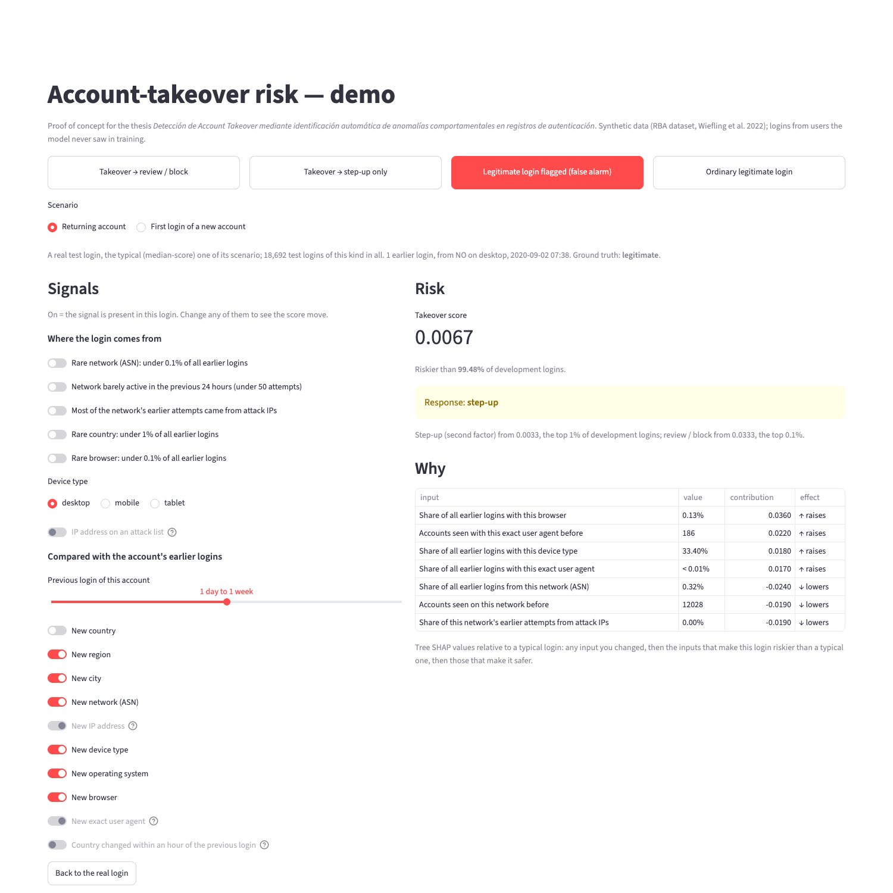

# 7 · Demo POC — account-takeover risk

Issue [#8](https://github.com/modsiw-mona/anomaly_detection_ato/issues/8) (CRISP-DM *deployment*; thesis objective
**OE4**, demonstrable prototype). Run instructions are in the [repository README](../../README.md#-demo--account-takeover-risk-issue-8).

## What it does

- **Choose a scenario, not a row number.** Buttons at the top pick a kind of outcome: takeover sent to review /
  block, takeover caught by step-up only, legitimate login flagged (false alarm), ordinary legitimate login. Each
  kind offers two scenarios, a **returning account** and an account's **first login**; each is a real login from
  the **test side** of the split (users the model never saw), the median-score login of its scenario.
- **Model:** the pipeline selected in issue #6 (`data/06_models/rba_model.joblib`, random forest on the
  behavioural, rarity, campaign and travel features), loaded with `src/inference/predict.py`.
- **Output:** the takeover score, how it ranks among development logins, the **response tier** with the thresholds
  of issue #7 (top 1% → step-up, top 0.1% → review / block), and **why**: tree SHAP contributions relative to a
  typical login (300 ordinary test logins), so "raises" means "riskier than a typical login".
- **Signals.** Every signal is a control set to the login's real value (on = the signal is present). Change
  any of them and the login is re-scored on the spot; inputs you changed are listed first under *Why*. They cover
  the input groups that weigh most in the model (notebook 07: global rarity, network activity and attack history,
  accounts sharing the network, device type, time since the previous login, account novelty).
    - *Where the login comes from:* rare network (under 0.1% of all earlier logins), network barely active in the
      previous 24 hours (under 50 attempts), most of the network's earlier attempts from attack IPs, rare country
      (under 1%), rare browser (under 0.1%), device type, and an attack-listed IP. Flipping one of the first five
      replaces its group of inputs with those of the typical (middle) real test login on the other side of the
      threshold; taking one real login, not a median per input, keeps the relations between its inputs (an IP
      never has more accounts or logins than its network). The three network switches describe one network, so
      flipping any of them takes all the network's inputs from a login matching all three switches at once (all
      eight combinations occur in the test data). The device type sets the device and its share of all logins.
    - *Compared with the account's earlier logins:* the time since the previous login, then new country, region,
      city, network, IP address, device type, operating system, browser, exact user agent, and a country change
      within an hour. On an account's **first** login there is no earlier login to compare with, so these are
      greyed out.
- **Rules between signals.** A control a rule fixes is greyed out and shows why on hover; once the rule no longer
  applies it gets back the value the viewer had given it, and "Back to the real login" resets everything. Rules
  are applied until they all agree (`src/inference/what_if.py`). Each holds without exception on the 7.1 million
  returning-account logins of the RBA feature table, and `tests/inference/test_what_if.py` checks them there:
    - something nobody had used before (country, network, IP, device type, operating system, browser, user agent)
      is new for this account too;
    - a new network means a new IP address; a new device type, operating system or browser means a new user
      agent; a new country means a new region when the region is known (no rule when the region or city is
      unknown);
    - a country change within an hour needs the previous login less than an hour earlier; a new country less
      than an hour after the previous login is a country change; if the account had used only one country, a
      country change is a new country;
    - every earlier attempt from an attack-listed IP is an attack attempt, and none from another IP, so the
      attack-IP switch also sets that IP's attack history; an IP's attempts are part of its network's, so a
      network with no earlier attack attempts has no attack-listed IP, and one whose earlier attempts all came
      from attack IPs has only attack-listed IPs.

  Two more follow from the definitions when a *where from* control replaces a value: if the account had only one
  earlier login, a different network, browser or device type is new for it; if it had used only one country, a
  different country is new.
- **Login details** (collapsed): the real login's facts, for reference; they do not change with the controls.
- **Plain-language names:** every input on screen is shown by what it means (e.g. "Share of all earlier logins
  from this country"); the login id, in *Login details*, is shown for reference only and is not a model input.

**What the switches show about the model.** On these scenarios, where a login comes from moves the score more
than what is new for the account. Turning *rare network* off brings the first-login takeover from 0.74 to 0.02 and
the returning-account one from 0.59 to 0.03 (review / block to step-up); turning *most attempts from attack IPs*
off brings the returning-account one to allow; turning off all five *where from* switches makes either look
ordinary (allow). The device type matters too (the returning-account takeover from desktop to mobile: 0.59 to
0.13). The account-novelty switches move scores less: on the ordinary returning-account scenario no combination
of them changes the response. Novelty is common in legitimate traffic too: 43% of legitimate returning-account
logins in development bring a new country, network, device type, operating system or browser for the account
(41% a new IP address), against 86% of the 71 returning-account takeover logins.

**Why not a form or a CSV upload?** The course's reference demo scores one row typed in a form, or a batch from a
CSV. Here a login's features describe it *against the account's history and all earlier traffic* (novelty, rarity,
network reputation), so they cannot be typed in from one raw login. The demo therefore starts from real logins the
model never saw, and lets you change their signals.

The model receives the data and produces predictions correctly: `tests/inference/` checks thresholds, tiers,
loading, explanations and value formatting, and runs the whole app with Streamlit's test runner on a toy data
directory (`tests/inference/test_app.py`): switches reach the model and the changed inputs are listed first,
implied signals follow their cause and return to their real value when it is switched off, the travel switch
follows the time since the previous login and gets back the viewer's value when the rule no longer applies, the
device type reaches the model, a first login greys out the history
signals, and "back to the real login" restores the original score. On the real data, every scenario was also
driven through 60 random control changes: no rule was broken and every reset restored the original score.

## Evidence

| | |
| --- | --- |
|  | **Takeover sent to review / block (returning account).** Three earlier logins; this one comes from a rare network, quiet in the previous 24 hours, with a 70% attack-IP history, from a rare country and browser. |
|  | **Takeover on a new account's first login.** There is no earlier login to compare with, so the account-history signals are greyed out; the score comes from where the login comes from. |
|  | **The same first-login takeover, rare network switched off.** The network's inputs move together to those of a real common, quiet, attack-heavy network; the score drops from 0.74 to 0.02 and the response from review / block to step-up. The changed inputs are listed first under *Why*. |
|  | **False alarm (returning account).** A legitimate login sent to step-up although none of the *where from* switches is on: the score comes from a combination of smaller signals. |

Screenshots taken from the running app with headless Chrome (temporary profile) on 2026-11-04. The demo binds to
`127.0.0.1` with Streamlit's usage statistics off, both in `make demo` and in `.streamlit/config.toml`.
