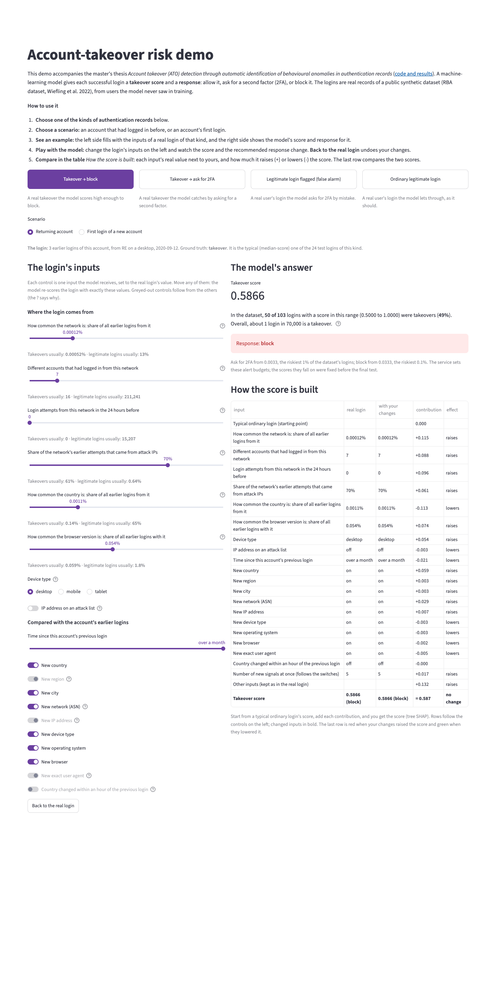
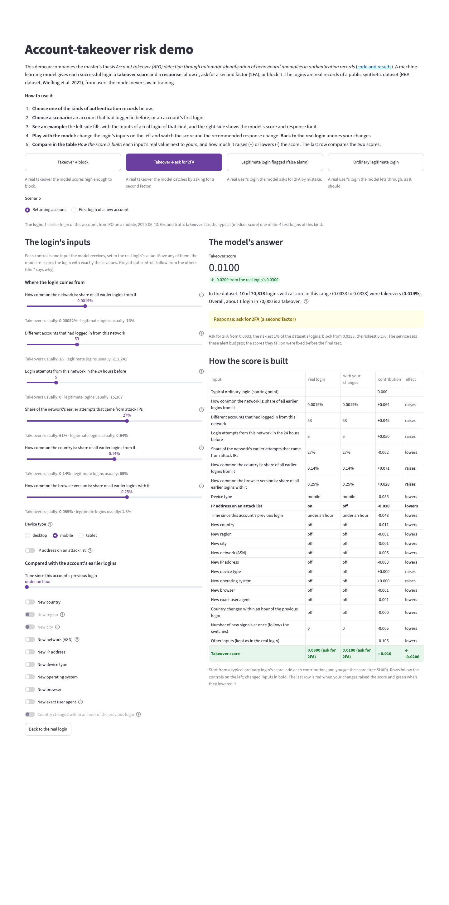

# 7 · Demo POC — account-takeover risk

Issue [#8](https://github.com/modsiw-mona/anomaly_detection_ato/issues/8) (CRISP-DM *deployment*; thesis objective
**OE4**, demonstrable prototype). Run instructions are in the [repository README](../../README.md#demo--account-takeover-risk-issue-8).

## What it does

- **The page explains itself.** It opens with what the demo is (the thesis title, in English and Spanish), what
  the model answers (a takeover score and a response) and three steps on how to use it.
- **Choose a real login, not a row number.** Buttons at the top pick a kind of outcome, each with one line on
  what it means: takeover blocked, takeover asked for 2FA, legitimate login flagged (false alarm), ordinary
  legitimate login. Each kind offers two scenarios, a **returning account** and an account's **first login**;
  each is a real login from the **test side** of the split (users the model never saw), the median-score login
  of its scenario.
- **Every control is one model input**, set to the real login's value. The model re-scores exactly the inputs
  shown; nothing is copied from another login (Google's What-If Tool works the same way: edit a data point's
  values and run the model again).
    - *Number inputs are sliders over plain steps*, the real value included: how common the network is (share of
      all earlier logins from it), different accounts that had logged in from it, login attempts from it in the
      24 hours before, the share of its earlier attempts that came from attack IPs, how common the country is,
      how common the browser version is. Under each slider, **where takeovers and legitimate logins usually are**
      (medians of the development side), so a viewer knows what a value means without knowing the data.
    - *Yes/no inputs are switches*: an attack-listed IP, and, compared with the account's earlier logins, new
      country, region, city, network, IP address, device type, operating system, browser, exact user agent, and a
      country change within an hour. Also the device type and the time since the previous login.
    - On an account's **first** login there is no earlier login to compare with, so the history inputs are
      greyed out.
- **Only combinations the data has.** A control that follows from others is greyed out with the reason on
  hover, and gets back the viewer's value once the rule no longer applies; "Back to the real login" resets
  everything. Each rule holds without exception in the RBA feature table, and
  `tests/inference/test_what_if.py` checks them there:
    - a network nobody had logged in from (0%) had no accounts, and one seen before had at least one account and
      a known attack history;
    - an IP is part of its network: it never has a bigger share of logins or more accounts than the network, and
      the network never has more failed attempts than attempts;
    - something nobody had used before is new for the account too; a new network means a new IP address; a new
      device type, operating system or browser means a new user agent; a new country means a new region when the
      region is known;
    - a country change within an hour needs the previous login less than an hour earlier; a new country less
      than an hour after the previous login is a country change; if the account had used only one country, a
      country change is a new country;
    - every earlier attempt from an attack-listed IP is an attack attempt (and none from another IP); a network
      with no attack attempts has no attack-listed IP, and one with only attack attempts has only such IPs.
- **The model's answer:** the takeover score, **what a score this high meant in the dataset** (for example "50 of
  the 103 development logins scoring 0.5 or more were takeovers", against about 1 in 70,000 overall), the
  **response** (allow, ask for 2FA, block) and the thresholds: the riskiest 1% of development logins (score
  0.0033) are asked for 2FA and the riskiest 0.1% (0.0333) are blocked. These alert budgets were fixed before
  any model was trained, and turned into scores in issue #7 before the test set was
  opened. The demo names the tiers of issue #7 in plain words: *block* for review / block and *ask for 2FA* for
  step-up authentication.
- **How the score is built:** one row per control, in the order of the controls on the left (rows never jump),
  with the real value, the current value, the tree-SHAP contribution and its effect; then the inputs that cannot
  be changed here, and the score. Contributions add up from a typical ordinary login's score (300 ordinary test
  logins) to this login's score. Changed rows are in bold; the last row is red when the changes raised the score
  and green when they lowered it.
- **Definitions on hover, where needed:** every number input and every name with a technical term (ASN, attack
  IPs, user agent, impossible travel) has a "?"; plain switches such as "New city" have none.

**What the inputs show about the model.** On the returning-account takeover (0.5866, block), moving one input at a
time to where legitimate logins usually are gives: network share 0.00012% → 13%: 0.14; accounts on the network 7 →
100,000: 0.23; attempts in the previous 24 hours 0 → 20,000: 0.24; attack history 70% → 1%: 0.39; country share
0.0011% → 65%: 0.28; browser share 0.054% → 1%: 0.31; mobile instead of desktop: 0.13. Each one lowers the score,
none alone takes the login out of *block*, and all six together give 0.0067 (ask for 2FA): the forest learned
combinations, so the inputs do not add up one by one. The attack history weighs this much because the data says
so: in development, logins from a rare, quiet network with mostly attack-IP history were takeovers 27 times in
10,000, against 0.8 in 10,000 for a rare, quiet network without it. The account-novelty switches move scores
less. Novelty is common in legitimate traffic too: 43% of legitimate returning-account logins in development
bring a new country, network, device type, operating system or browser for the account (41% a new IP address),
against 86% of the 71 returning-account takeover logins.

A viewer can also build logins that never happened: the model is predictive and scores any combination of
inputs. Far from the logins it learned from, its answer rests on less evidence; the rules above keep at least the
combinations the data never allows out of reach.

**Why not a form or a CSV upload?** A common demo design scores one row typed in a form, or a batch from a
CSV. Here a login's features describe it *against the account's history and all earlier traffic* (novelty, rarity,
network reputation), so a raw login cannot be typed in. The demo therefore starts from real logins the model never
saw and lets you change their inputs, with the usual values beside each one.

The model receives the data and produces predictions correctly: `tests/inference/` checks thresholds, tiers,
loading, explanations and value formatting, and runs the whole app with Streamlit's test runner on a toy data
directory (`tests/inference/test_app.py`): a slider sets exactly the input it names, a never-seen network has no
accounts, the table keeps the controls' order, ends with the score and adds up to it, technical terms are
explained, implied switches follow their cause, the travel switch follows the time since the previous login,
the device type reaches the model, a first login greys out the history inputs, and "Back to the real login"
restores the original score. On the real data, every scenario was also driven through 60 random control changes:
no rule was broken, the table always added up to the score, and every reset restored the original score.

## Evidence

| | |
| --- | --- |
|  | **Takeover blocked (returning account).** The introduction (with a link to this repository) and the five steps at the top; three earlier logins; the network is rare (0.00012% of logins, 7 accounts), quiet in the previous 24 hours and has a 70% attack-IP history, from a rare country and browser. Under each slider, where takeovers and legitimate logins usually are; on the right, what a score of 0.59 meant in the dataset (50 of 103 logins were takeovers) and how the score is built. |
|  | **Takeover on a new account's first login.** There is no earlier login to compare with, so the account-history inputs are greyed out; the score comes from where the login comes from. |
|  | **The takeover asked for 2FA, its attack-listed IP switched off.** Only that input changes; its row is in bold and the last row turns green: 0.0300 to 0.0100, still ask for 2FA. |
|  | **False alarm (returning account).** A legitimate login asked for 2FA: the score comes from a combination of smaller contributions. |

Screenshots taken from the running app with headless Chrome (temporary profile) on 2026-11-08. The demo binds to
`127.0.0.1` with Streamlit's usage statistics off, both in `make demo` and in `.streamlit/config.toml`.
