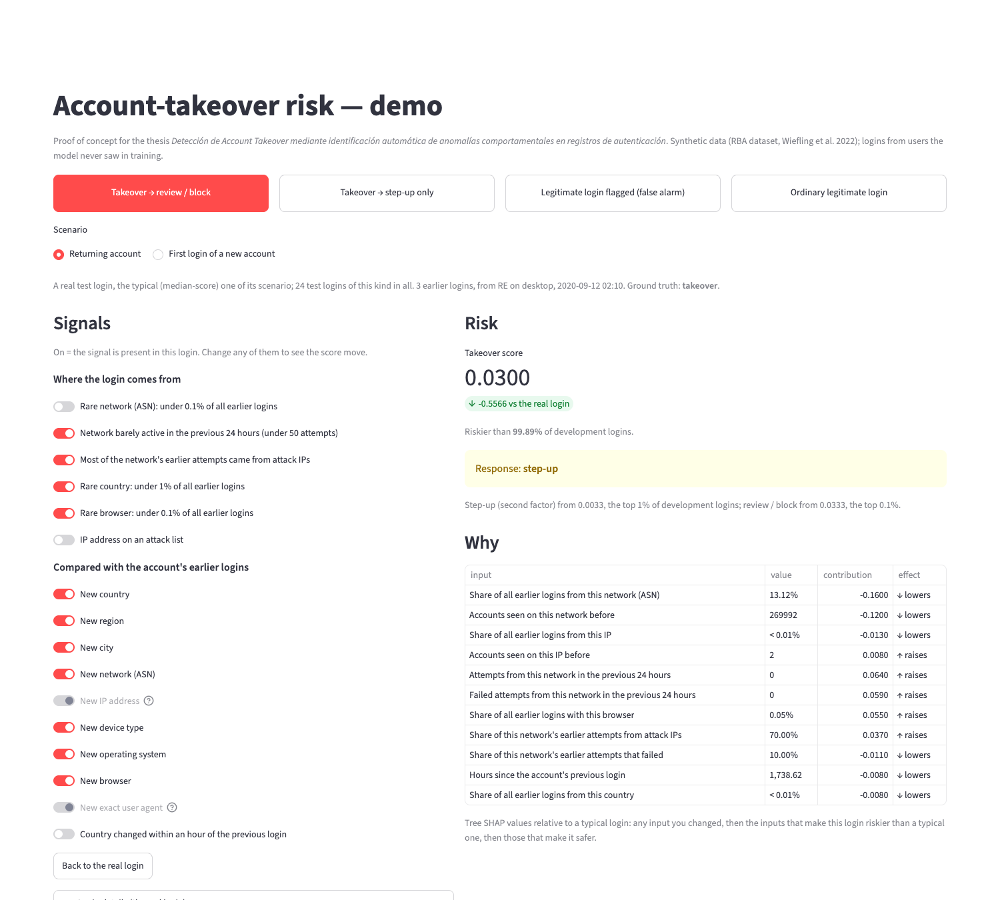
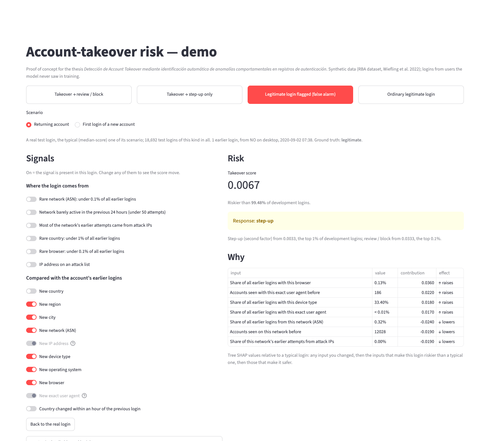
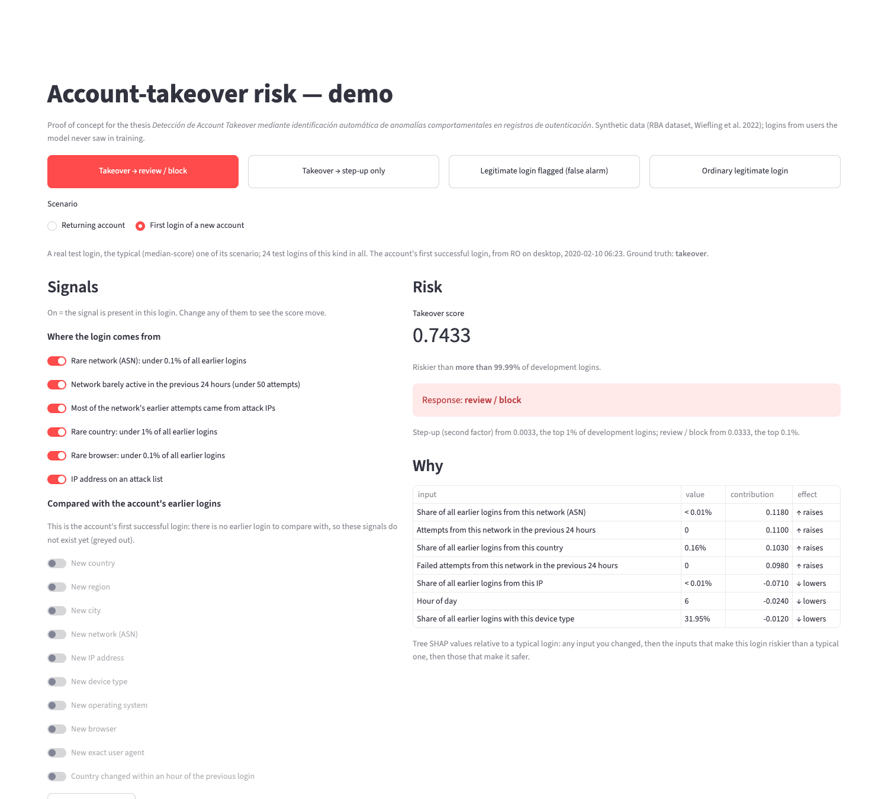

# 7 · Demo POC — account-takeover risk

Issue [#8](https://github.com/modsiw-mona/anomaly_detection_ato/issues/8) (CRISP-DM *deployment*; thesis objective
**OE4**, demonstrable prototype). Run instructions are in the [repository README](../../README.md#demo--account-takeover-risk-issue-8).

## What it does

- **Choose a scenario, not a row number.** Buttons at the top pick a kind of outcome: takeover sent to review /
  block, takeover caught by step-up only, legitimate login flagged (false alarm), ordinary legitimate login. Each
  kind offers two scenarios, a **returning account** and an account's **first login**; each is a real login from
  the **test side** of the split (users the model never saw), the median-score login of its scenario.
- **Model:** the pipeline selected in issue #6 (`data/06_models/rba_model.joblib`, random forest on the
  behavioural, rarity, campaign and travel features), loaded with `src/inference/predict.py`.
- **Output:** the takeover score, how it ranks among development logins, the **response tier** with the thresholds
  of issue #7 (top 1% → step-up, top 0.1% → review / block), and **why**: tree SHAP contributions relative to a
  typical login (300 ordinary test logins), so "raises" means "riskier than a typical login".
- **Signals.** Every signal is a switch set to the login's real value (on = the signal is present). Flip any of
  them and the login is re-scored on the spot; inputs you changed are listed first under *Why*.
    - *Where the login comes from:* rare network (under 0.1% of all earlier logins), network barely active in the
      previous 24 hours (under 50 attempts), most of the network's earlier attempts from attack IPs, rare country
      (under 1%), rare browser (under 0.1%), and an attack-listed IP. Each of the first five moves a group of
      inputs at once (for example, rare network moves the network's and the IP's share of all logins and the
      number of accounts seen on them): flipping it replaces that group with the median values of the test
      logins on the other side of the threshold. The thresholds sit between development takeovers and
      development legitimate logins (for example, 90% of development takeovers come from networks with under
      0.05% of all logins; 90% of legitimate logins, from networks with more than 0.13%).
    - *Compared with the account's earlier logins:* new country, region, city, network, IP address, device type,
      operating system, browser, exact user agent, and a country change within an hour. A signal that always
      comes with another is switched with it (a new network always means a new IP address; a new device type,
      operating system or browser always means a new user agent; no exception in the data). On an account's
      **first** login there is no earlier login to compare with, so these signals are greyed out.
- **Plain-language names:** every input on screen is shown by what it means (e.g. "Share of all earlier logins
  from this country"); the login id, in *Login details*, is shown for reference only and is not a model input.

**What the switches show about the model.** Where a login comes from weighs far more than what is new for the
account. Turning *rare network* off moves the review / block takeover from 0.59 to 0.03 (still step-up); turning
off all five *where from* switches makes it look ordinary (allow). The account-novelty switches move scores much
less: on the ordinary returning-account scenario no combination of them changes the response. Novelty is common
in legitimate traffic too: 43% of legitimate returning-account logins in development bring a new network, device
type, operating system or browser for the account (41% a new IP address), against 86% of takeovers.

**Why not a form or a CSV upload?** The course's reference demo scores one row typed in a form, or a batch from a
CSV. Here a login's features describe it *against the account's history and all earlier traffic* (novelty, rarity,
network reputation), so they cannot be typed in from one raw login. The demo therefore starts from real logins the
model never saw, and lets you change their signals.

The model receives the data and produces predictions correctly: `tests/inference/` checks thresholds, tiers,
loading, explanations and value formatting, and runs the whole app with Streamlit's test runner on a toy data
directory (`tests/inference/test_app.py`): switches reach the model, implied signals follow their cause, a first
login greys out the history signals, and "back to the real login" restores the original score.

## Evidence

| | |
| --- | --- |
|  | **Takeover sent to review / block (returning account).** Three earlier logins; this one comes from a rare network, quiet in the previous 24 hours, with a 70% attack-IP history, from a rare country and browser. |
|  | **The same takeover, rare network switched off.** The score drops from 0.59 to 0.03 and the response from review / block to step-up; the changed inputs are listed first under *Why*. |
|  | **False alarm (returning account).** A legitimate login sent to step-up although none of the *where from* switches is on: the score comes from a combination of smaller signals. |
|  | **Takeover on a new account's first login.** There is no earlier login to compare with, so the account-history signals are greyed out; the score comes from where the login comes from. |

Screenshots taken from the running app with headless Chrome (temporary profile) on 2026-11-04. The demo binds to
`127.0.0.1` with Streamlit's usage statistics off, both in `make demo` and in `.streamlit/config.toml`.
