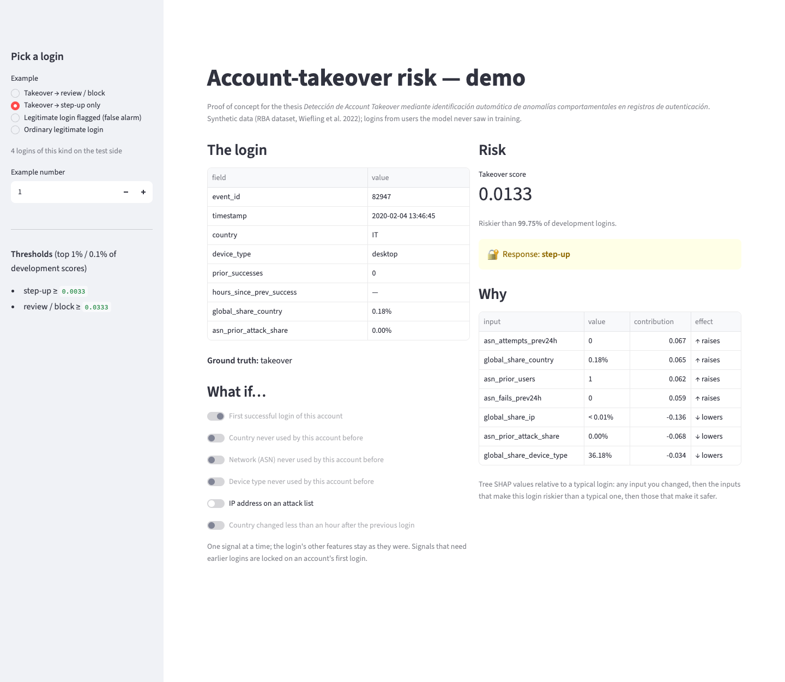
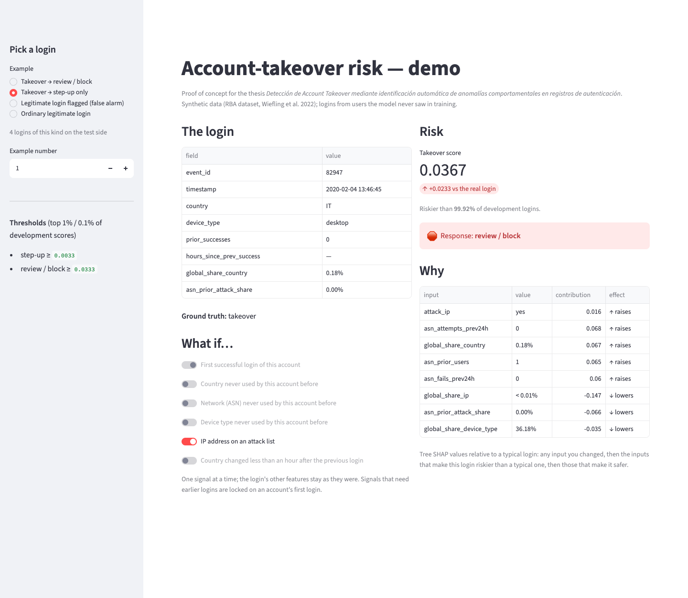

# 7 · Demo POC — account-takeover risk

Issue [#8](https://github.com/modsiw-mona/anomaly_detection_ato/issues/8) (CRISP-DM *deployment*; thesis objective
**OE4**, demonstrable prototype). Run instructions are in the [repository README](../../README.md#-demo--account-takeover-risk-issue-8).

## What it does

- **Input:** a successful login from the **test side** of the split (users the model never saw), chosen by kind:
  takeover sent to review, takeover caught by step-up only, legitimate login flagged (false alarm), ordinary login.
- **Model:** the pipeline selected in issue #6 (`data/06_models/rba_model.joblib`, random forest on the
  behavioural, rarity, campaign and travel features), loaded with `src/inference/predict.py`.
- **Output:** the takeover score, how it ranks among development logins, the **response tier** with the thresholds
  of issue #7 (top 1% → step-up, top 0.1% → review / block), and **why**: tree SHAP contributions relative to a
  typical login (300 ordinary test logins), so "raises" means "riskier than a typical login".
- **What if…:** switch one behavioural signal (new country / network / device, attack-IP address, country change
  within an hour) and the login is re-scored on the spot; the other features stay as they were (the count of new
  key signals is updated). Signals that need earlier logins are locked on an account's first login, and whether a
  login is the first is shown but cannot be changed.

**Why not a form or a CSV upload?** The course's reference demo scores one row typed in a form, or a batch from a
CSV. Here a login's features describe it *against the account's history and all earlier traffic* (novelty, rarity,
network reputation), so they cannot be typed in from one raw login. The demo therefore picks real logins the model
never saw, and lets you change the behavioural signals that a form would have exposed.

The model receives the data and produces predictions correctly: `tests/inference/` checks thresholds, tiers,
loading, explanations and value formatting, and runs the whole app with Streamlit's test runner on a toy data
directory (`tests/inference/test_app.py`), including a *what if* change.

## Evidence

| | |
| --- | --- |
|  | **Takeover sent to review / block.** A first login from Romania over a network with a 74% attack-IP history; riskier than more than 99.99% of development logins. |
|  | **Takeover caught by step-up only.** A first login from Italy with common client values: not in the top 0.1%, but in the top 1%. |
|  | **False alarm.** A legitimate login from an uncommon country (1.75% of logins), an IP no one had used before and a user agent shared by only two accounts. |
|  | **What if.** The same Italy takeover, had it come from an attack-listed IP, would move from step-up to review / block; the changed input is listed first under *Why*. |

Screenshots taken from the running app with headless Chrome (temporary profile) on 2026-11-04. The demo binds to
`127.0.0.1` with Streamlit's usage statistics off, both in `make demo` and in `.streamlit/config.toml`.
