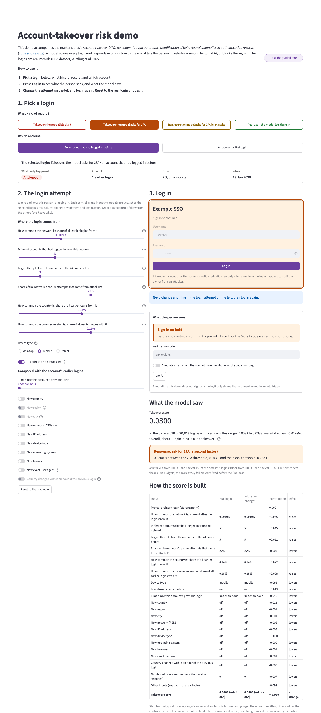
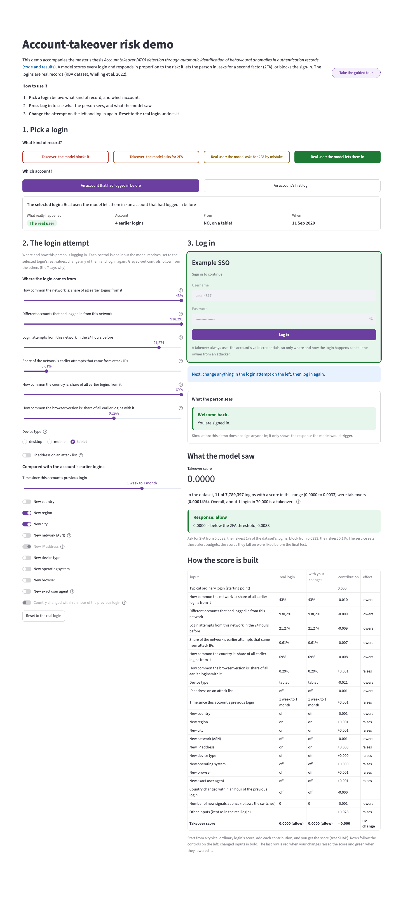
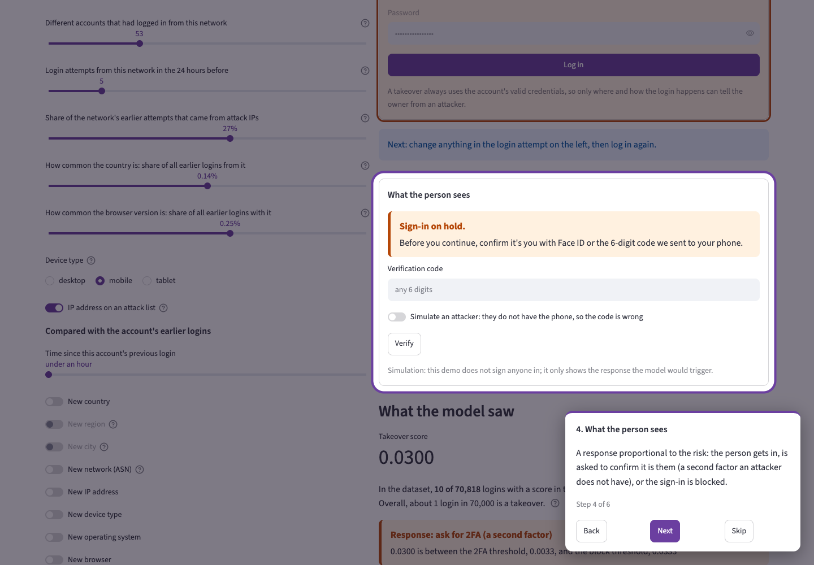

# 7 · Demo POC — account-takeover risk

Issue [#8](https://github.com/modsiw-mona/anomaly_detection_ato/issues/8) (CRISP-DM *deployment*; thesis objective
**OE4**, demonstrable prototype). Run instructions are in the [repository README](../../README.md#demo--account-takeover-risk-issue-8).

## What it does

- **The page explains itself.** It opens with what the demo is (the thesis title, with a link to this
  repository) and what the model gives each login (a takeover score and a proportional response), in two
  sentences, then three short steps; *Take the guided tour* sits next to them. The page is numbered: 1. pick a
  login, 2. the login attempt, 3. log in.
- **Choose a real login, not a row number.** A row of buttons picks the kind of record, each label saying what
  it is and what the model did ("Takeover: the model blocks it", "Real user: the model asks for 2FA by mistake",
  and so on), each in the colour of the outcome: red block, orange 2FA, yellow false alarm, green let in. A second
  row of buttons the same size picks the account: one that had logged in before, or an
  account's first login. Each is a real login from the **test side** of the split (users the model never saw),
  the median-score login of its scenario. A card then shows **the selected login** at a glance: its name, what
  really happened (a takeover or the real user, as a red or green label), the account's earlier logins, where
  from and when.
- **Every control is one model input**, set to the real login's value. The model re-scores exactly the inputs
  shown; nothing is copied from another login (Google's What-If Tool works the same way: edit a data point's
  values and run the model again).
    - *Number inputs are sliders over plain steps*, the real value included: how common the network is (share of
      all earlier logins from it), different accounts that had logged in from it, login attempts from it in the
      24 hours before, the share of its earlier attempts that came from attack IPs, how common the country is,
      how common the browser version is. Each slider's "?" says what it measures and **where takeovers and
      legitimate logins usually are** (medians of the development side), so a viewer knows what a value means
      without knowing the data, and the page stays short.
    - *Yes/no inputs are switches*: an attack-listed IP, and, compared with the account's earlier logins, new
      country, region, city, network, IP address, device type, operating system, browser, exact user agent, and a
      country change within an hour. Also the device type and the time since the previous login.
    - On an account's **first** login there is no earlier login to compare with, so the history inputs are
      greyed out.
- **Only combinations the data has.** A control that follows from others is greyed out with the reason on
  hover, and gets back the viewer's value once the rule no longer applies; "Reset to the real login" resets
  everything. Each rule holds without exception in the RBA feature table, and
  `tests/inference/test_what_if.py` checks them there:
    - a network nobody had logged in from (0%) had no accounts, and one seen before had at least one account and
      a known attack history;
    - an IP is part of its network: it never has a bigger share of logins or more accounts than the network, and
      the network never has more failed attempts than attempts;
    - something nobody had used before is new for the account too; a new network means a new IP address; a new
      device type, operating system or browser means a new user agent; a new country means a new region when the
      region is known;
    - a country change within an hour needs the previous login less than an hour earlier; a new country less
      than an hour after the previous login is a country change; if the account had used only one country, a
      country change is a new country;
    - every earlier attempt from an attack-listed IP is an attack attempt (and none from another IP); a network
      with no attack attempts has no attack-listed IP, and one with only attack attempts has only such IPs.
- **A simulated sign-in (issue #30).** The left side is *the login attempt*: where and how the person logs in.
  The right side is a generic sign-in card ("Example SSO") with the username and password filled in: in a
  takeover always uses the account's valid credentials. The score stays hidden until **Log in**. Then the card
  reacts like a real sign-in: a refused login shakes it and turns it red (blocked) or orange (2FA); one that goes
  through turns it green. Below, the message the person would see, as a real service shows it: *Welcome back*;
  *Sign-in on hold*, asking to confirm with Face ID or a code, with the whole flow (enter any 6 digits and
  Verify: *Identity verified*; switch on "Simulate an attacker", who does not have the phone: *Verification
  failed*, the sign-in is blocked); or *Sign-in blocked*, the security team reviewing it. All marked as a
  simulation. Below that, what the model saw. Changing any input asks to log in again, so each response belongs
  to the attempt shown.
- **Feedback at every step.** A hint under the card always says what to do next (press Log in; change the attempt
  and log in again). A short notice confirms each login, another flags at once that the attempt changed, and the
  button then reads *Log in again*. After each login the page scrolls to the response, or, when the attempt
  differs from the real login, to the table that compares the two.
- **Guided tour.** *Take the guided tour* dims the page and highlights one part at a time (the kinds of record,
  the login attempt, the sign-in card, what the person sees, what the model saw), with Back, Next and Skip. It is
  plain CSS (a highlighted container above a dimmed page); a tiny script only scrolls the part into view.
- **What the model saw:** the takeover score, **what a score this high meant in the dataset** (for example "50 of
  the 103 development logins scoring 0.5 or more were takeovers", against about 1 in 70,000 overall), the
  **response** (allow, ask for 2FA, block until verified), where the score falls against the two thresholds, and
  the thresholds themselves: the riskiest 1% of development logins (score
  0.0033) are asked for 2FA and the riskiest 0.1% (0.0333) are blocked. These alert budgets were fixed before
  any model was trained, and turned into scores in issue #7 before the test set was
  opened. The demo names the tiers of issue #7 in plain words: *block* for review / block and *ask for 2FA* for
  step-up authentication.
- **How the score is built:** one row per control, in the order of the controls on the left (rows never jump),
  with the real value, the current value, the tree-SHAP contribution and its effect; then the inputs that cannot
  be changed here, and the score. Contributions add up from a typical ordinary login's score (300 ordinary test
  logins) to this login's score. Changed rows are in bold; the last row is red when the changes raised the score
  and green when they lowered it.
- **Definitions on hover, where needed:** every number input and every name with a technical term (ASN, attack
  IPs, user agent, impossible travel) has a "?"; plain switches such as "New city" have none.

**What the inputs show about the model.** On the returning-account takeover (0.5866, block), moving one input at a
time to where legitimate logins usually are gives: network share 0.00012% → 13%: 0.14; accounts on the network 7 →
100,000: 0.23; attempts in the previous 24 hours 0 → 20,000: 0.24; attack history 70% → 1%: 0.39; country share
0.0011% → 65%: 0.28; browser share 0.054% → 1%: 0.31; mobile instead of desktop: 0.13. Each one lowers the score,
none alone takes the login out of *block*, and all six together give 0.0067 (ask for 2FA): the forest learned
combinations, so the inputs do not add up one by one. The attack history weighs this much because the data says
so: in development, logins from a rare, quiet network with mostly attack-IP history were takeovers 27 times in
10,000, against 0.8 in 10,000 for a rare, quiet network without it. The account-novelty switches move scores
less. Novelty is common in legitimate traffic too: 43% of legitimate returning-account logins in development
bring a new country, network, device type, operating system or browser for the account (41% a new IP address),
against 86% of the 71 returning-account takeover logins.

A viewer can also build logins that never happened: the model is predictive and scores any combination of
inputs. Far from the logins it learned from, its answer rests on less evidence; the rules above keep at least the
combinations the data never allows out of reach.

**Why not a form or a CSV upload?** A common demo design scores one row typed in a form, or a batch from a
CSV. Here a login's features describe it *against the account's history and all earlier traffic* (novelty, global frequency,
network reputation), so a raw login cannot be typed in. The demo therefore starts from real logins the model never
saw and lets you change their inputs, with the usual values beside each one.

The model receives the data and produces predictions correctly: `tests/inference/` checks thresholds, tiers,
loading, explanations and value formatting, and runs the whole app with Streamlit's test runner on a toy data
directory (`tests/inference/test_app.py`): a slider sets exactly the input it names, a never-seen network has no
accounts, the table keeps the controls' order, ends with the score and adds up to it, technical terms are
explained, implied switches follow their cause, the travel switch follows the time since the previous login,
the device type reaches the model, a first login greys out the history inputs, and "Reset to the real login"
restores the original score. On the real data, every scenario was also driven through 60 random control changes:
no rule was broken, the table always added up to the score, and every reset restored the original score.

## Public deployment (Streamlit Community Cloud)

Live at <https://anomalydetection-ato.streamlit.app>.

The full feature table and score files are gitignored and far too large for a free host, so the demo reads a
small **bundle** instead (`src/inference/bundle.py`): the eight scenario logins, the 300 reference logins of the
explanations, the alert thresholds and the summaries the page shows (about 70 KB), plus the model (9.8 MB).

- **Where the app gets its data.** With the full data in `data/` (`ATO_DATA_DIR`), it builds the bundle in memory,
  as before. Otherwise it reads a bundle folder (`ATO_BUNDLE_DIR`), or downloads the published one.
- **Published bundle.** The files are attached to the GitHub Release
  [`demo-bundle-v1`](https://github.com/modsiw-mona/anomaly_detection_ato/releases/tag/demo-bundle-v1), never
  committed. [`bundle.json`](bundle.json) records their SHA-256, and the app checks every file against it before
  loading anything (the model file is a pickle, so an unverified one is never loaded). The page shown from the
  bundle is identical to the one built from the full data (checked for every kind of outcome).
- **Dependencies.** [`requirements.txt`](requirements.txt) is exported from `uv.lock` with hashes. Streamlit Community
  Cloud uses it because it sits next to the app. scikit-learn and numpy are pinned to the versions the model file
  was saved with (recorded in `bundle.json` and checked by a test), so a later Dependabot update of `uv.lock` cannot
  break the public app.
- **Refreshing it** after the model or the dependencies change:
  `make demo_bundle RELEASE=demo-bundle-v2`, attach the files in `data/08_reporting/demo_bundle/` to a new release
  of that name, and commit the new `bundle.json` and `requirements.txt`.
- **Deploying it** (once, from the Streamlit Community Cloud dashboard, signed in with GitHub): repository
  `modsiw-mona/anomaly_detection_ato`, branch `main`, main file `notebooks/7-deploy/app.py`, and in *Advanced
  settings* **Python 3.14** (the code uses Python 3.14's deferred annotations; Streamlit's default is 3.12). No
  secrets are needed.
- **Locally** `make demo` still serves on `127.0.0.1` only, with usage statistics off.

## Evidence

| | |
| --- | --- |
|  | **Takeover, sign-in blocked (returning account).** The attempt on the left: three earlier logins; a rare network (0.00012% of logins, 7 accounts), quiet in the previous 24 hours, with a 70% attack-IP history; a rare country and browser. After **Log in**, the card shakes and turns red and the person sees "Sign-in blocked"; the model saw a score of 0.5866, above the block threshold, where 50 of 103 development logins were takeovers, and the table shows how the score is built. |
|  | **Takeover, asked for a second factor.** The card turns orange and the sign-in is on hold until the person confirms it is them with Face ID or a code sent to the account's phone, which the attacker does not have; the score, 0.0300, falls between the two thresholds. |
|  | **Ordinary legitimate login, allowed.** "Welcome back": a common network, country and browser give a score of 0.0000, below the 2FA threshold; every contribution is small. |
|  | **Guided tour, step 4 of 6.** The page is dimmed except the part the step explains (here, what the person sees), with Back, Next and Skip. |

Screenshots taken from the running app with headless Chrome (temporary profile) on 2026-11-09. `make demo`
binds to `127.0.0.1` with Streamlit's usage statistics off.
